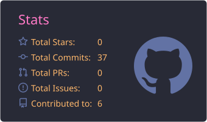
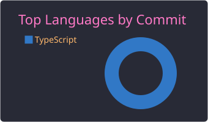
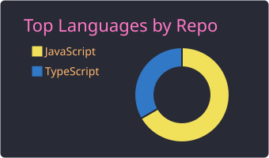
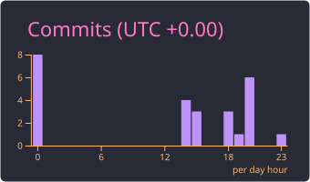

 

---

## 👨‍💻 Sobre mim

- 🔭 Atualmente construindo projetos full stack com **React**, **Node.js** e **TypeScript**
- 🌱 Sempre aprendendo algo novo sobre desenvolvimento web
- 💡 Gosto de criar interfaces limpas e APIs robustas, do front ao back-end
- 🤝 Aberto a colaborações e a novas oportunidades

---

## 🛠️ Tecnologias

  

---

## 📊 Estatísticas do GitHub

  
  
  
  

  

---

<!--
## 🚀 Projetos em destaque
Remova os comentários e troque NOME-DO-REPOSITORIO pelo nome real do repositório.

  

---
-->

## 🏢 Organizações

  
   
  <b><a href="https://github.com/Limiar-Consultoria-Esportiva">Limiar Consultoria Esportiva</a></b>
   
  Membro e colaborador · <a href="https://www.soulimiar.com.br/">soulimiar.com.br</a>

---

## 📬 Vamos conversar?

  
  

 

