<picture><source media="(max-width: 600px), (min-width: 768px) and (max-width: 1011px)" srcset="assets/hero-m.svg"></picture>
<picture><source media="(max-width: 600px), (min-width: 768px) and (max-width: 1011px)" srcset="assets/linha-m.svg"></picture>

&nbsp;&nbsp;&nbsp;&nbsp;

